# Booking System for Stays and Tables

[](https://github.com/Lotmanine/wp-booking-quote-system/actions/workflows/checks.yml)

GitHub Actions runs PHPCS on the plugin and theme, PHPStan level 6 on the plugin, the WordPress
PHPUnit suite against MariaDB and the Laravel PHPUnit suite on every push to main and every pull
request. Playwright, the parallel
hold script and the mutation check need the full stack and are run locally.

A working booking system for places to stay and places to eat, built on WordPress and WooCommerce,
with a host and admin back office, a Laravel dispatch service and n8n automation. A guest searches by
where, when and who, opens a listing, picks nights or a table time on the booking card, holds it for
ten minutes and pays a test deposit. Hosts confirm requests, check guests in, block dates and refund
deposits from their own dashboard.

**Quillmoor is invented.** The places, hosts and prices are fictional, nothing can really be booked,
and Stripe runs in test mode only. The interface follows the familiar patterns of large booking
sites (search pill, category row, photo grid, listing page with a sticky booking card); the brand,
colours and type are its own. There are no ratings or reviews, because there are no real guests.

Built by [Lotfi Otmanine](https://oldev.site).

## What it does

- **Two kinds of listing:** stays (cabins, villas, cottages, lofts, a boathouse, a beach house)
  booked by the night, and places to eat (a bistro, a tasting menu, a garden terrace, a cafe, a wine
  bar) booked by the table for a party size at a time slot.
- **Search and explore:** a where, when and who pill for stays or restaurants, a category row, a
  photo-first grid with photo swiping, and a Leaflet map with price pins on OpenStreetMap tiles.
  With dates, the grid shows only places that are free.
- **Listing pages:** a gallery mosaic and lightbox, highlights, rooms, opening hours, amenities,
  extras, an approximate area map, house rules, the cancellation policy and a host panel.
- **Booking card:** a range calendar that greys out booked, held and blocked nights, a party size
  and time chips for tables, extras, and a live price breakdown computed on the server.
- **Pricing:** nightly, Friday and Saturday, and seasonal rates, cleaning fees, extras charged per
  booking, per night or per guest, set menus per guest, and deposit rules (percentage, per guest,
  flat, first night).
- **Holds and double-booking protection:** nights and seats are held for ten minutes. A unique key on
  (listing, night) decides who gets a night; a conditional update decides who gets the last seats in
  a time slot. Both hold under truly parallel requests.
- **Deposits and refunds:** through WooCommerce and Stripe in test mode, HPOS and Checkout block
  compatible. Hosts refund cancelled, declined or no-show deposits through the gateway.
- **State machine:** quote, hold, deposit paid, requested, confirmed, arrived (checked in or seated),
  completed, or no-show, declined, cancelled. Instant book confirms at once; otherwise the host has 24
  hours to answer or the request is declined automatically.
- **Host back office:** a dashboard (requests to answer, arrivals this week, holds, deposits), a
  filtered bookings list, a booking page with accept, decline, check in, no-show, cancel, refund,
  internal notes, AI triage review and the full history, and an availability calendar to block
  nights or close days. Listings are edited with versioned Secure Custom Fields groups: photos,
  location with a map picker, rooms and guests or seats per slot, opening hours and slot length,
  nightly and seasonal rates, extras, house rules, cancellation policy, amenities and a price preview.
- **Scoping:** a host sees and changes only their own listings, uploads and bookings. The manager
  sees every host and manages locations, categories and amenities, without being a WordPress
  administrator.
- **Guest trips:** upcoming, past and cancelled trips, deposits and refunds, a timeline, date and time
  changes, cancellation under the listing's policy, and PDF quotes and confirmations.
- **Guest checkout, account after payment:** a visitor reserves and pays the deposit without an
  account, behind a Turnstile check. Only once the deposit is confirmed paid does the address get a
  guest account, with one email to set a password, capped per day and removed by the nightly reset.
- **Automation and CRM:** booking events go to n8n through a signed outbox, FluentCRM stages follow
  them, and AI suggestions wait for a person. Without a Brevo key, email goes out through an n8n
  workflow that checks an HMAC signature, a time window and a single-use nonce.
- **Hardening:** Wordfence with its firewall in extended protection, brute force and rate limits,
  visitor addresses trusted only from the proxy network, XML-RPC and the public user list closed.
- **Demo safety:** a banner on every page, restricted demo logins, a nightly reset that restores the
  seed listings and removes visitor uploads, and honest "not set up yet" states while Stripe,
  Turnstile or Brevo keys are missing.

## Architecture

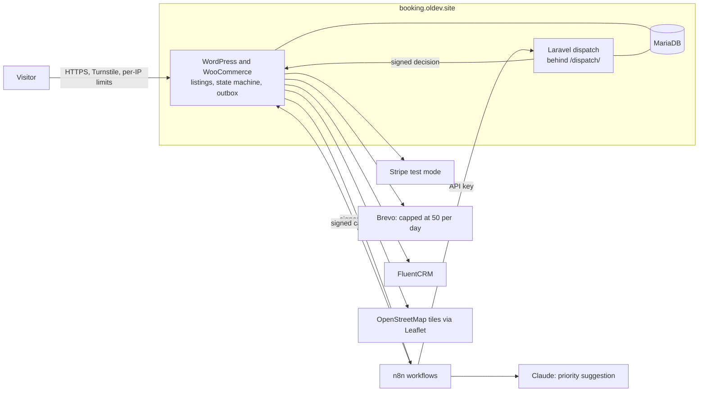

WordPress owns the booking state. n8n and the dispatch service can only ask for changes through
signed callbacks, and every change passes through one state machine. See [PLAN.md](PLAN.md) for the
original data model, message contracts and threat model.

### Decisions worth a look

**The database decides who gets a night.** A stay claims all its nights in one multi-row insert
against `UNIQUE(listing_id, night)`. If any night is taken the whole statement fails, so there is no
gap between checking and writing, and no half-claimed stay. Host blocks live in the same table, so a
blocked night can never be booked.

**The database decides who gets a seat.** Each time slot is a row with a capacity and a booked count.
Seats are taken with `UPDATE ... SET booked = booked + n WHERE booked + n <= capacity`, so a party is
refused the moment the slot would overflow. A claim row is deleted before its seats are returned, so
racing expiry sweeps cannot give seats back twice.

**Prices are never computed in the browser.** The booking card asks the server for every breakdown,
and the host's price preview uses the same route, so what a host previews is what a guest pays.

**Signed messages survive JSON parsers.** The payload travels as a JSON string inside JSON, so its
exact bytes reach the verifier even through an n8n webhook. Every receiver checks the key id, a 300
second timestamp window, the signature in constant time, and then a single-use nonce.

**Live payments are impossible by construction.** `sk_live_`, `rk_live_` and `pk_live_` values are
refused at boot and on save, and a live key closes every booking route and removes every gateway.

**Field groups are code.** The listing fields are registered with `acf_add_local_field_group`, so
they are versioned and identical on every install, and the seeder writes the same meta layout.

**The card says what is not set up.** Without Turnstile keys, only signed-in accounts can reserve.
Without Stripe test keys, a hold still works and shows the real availability, and the payment step
says that payments are not set up instead of failing.

## Screenshots

| Home and search | Explore with the map |
|---|---|
|  | 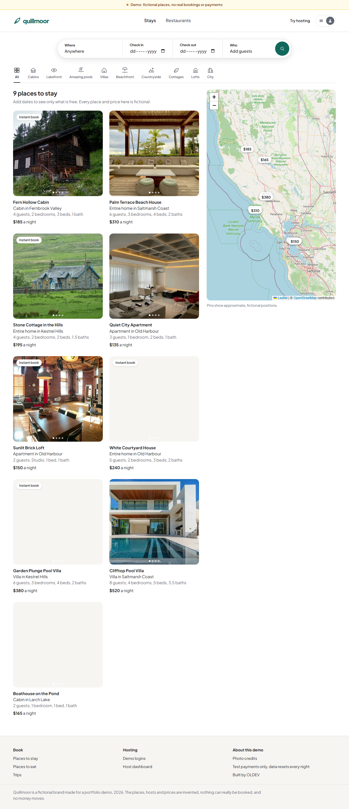 |

| A stay | A place to eat |
|---|---|
| 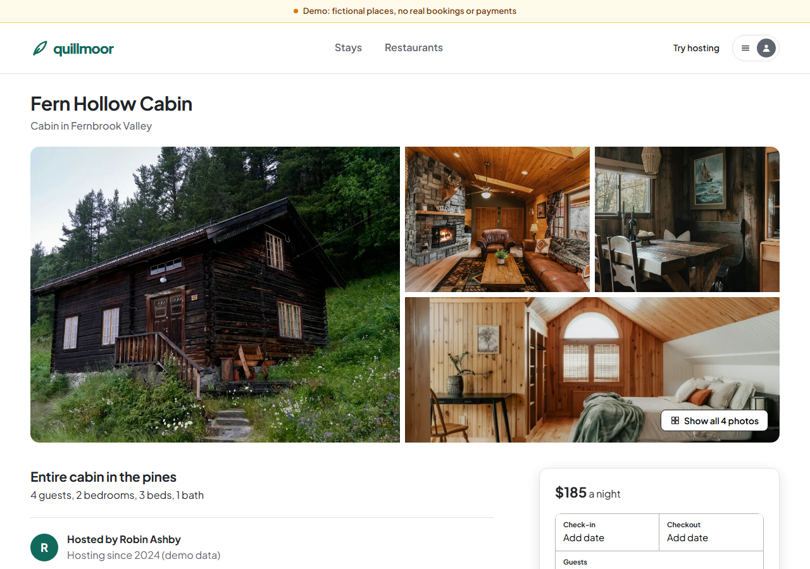 | 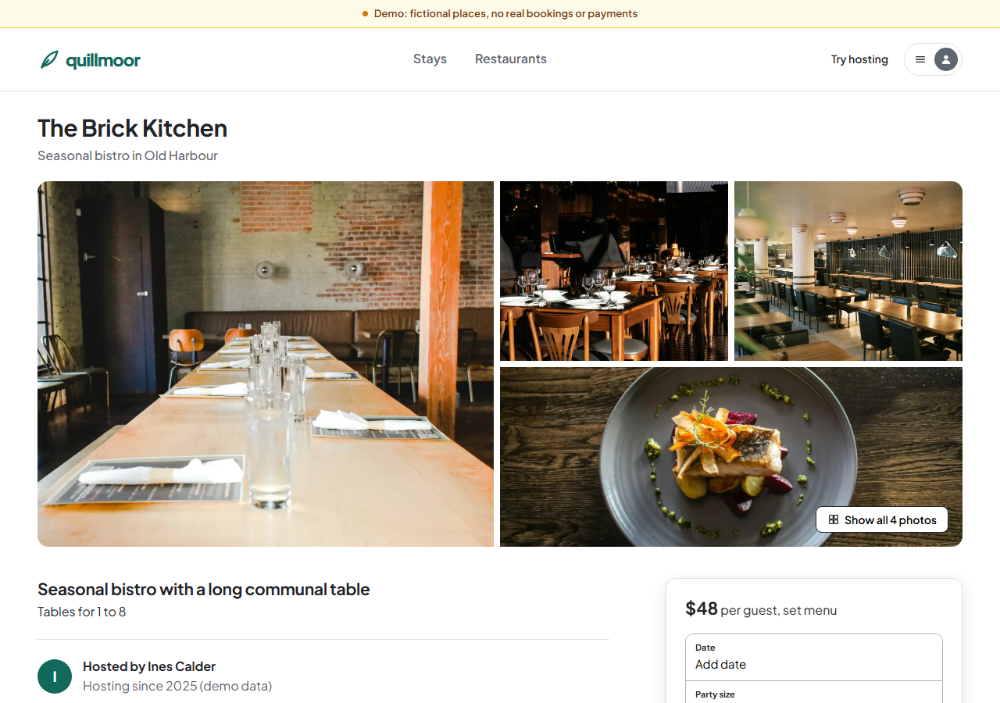 |

| Nights on hold | Trips |
|---|---|
| 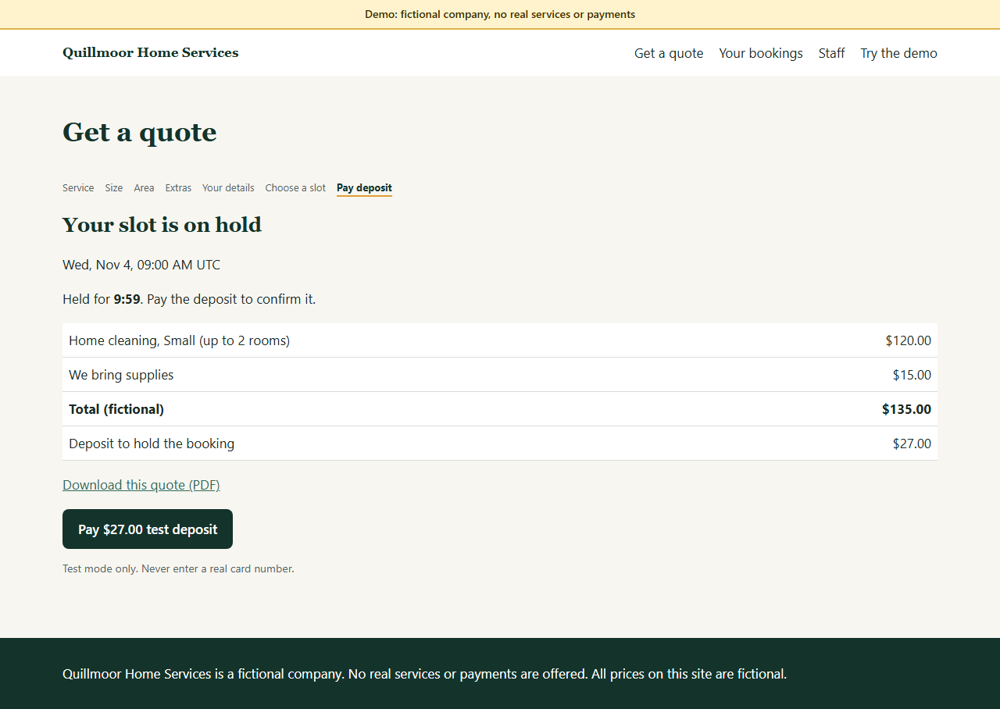 | 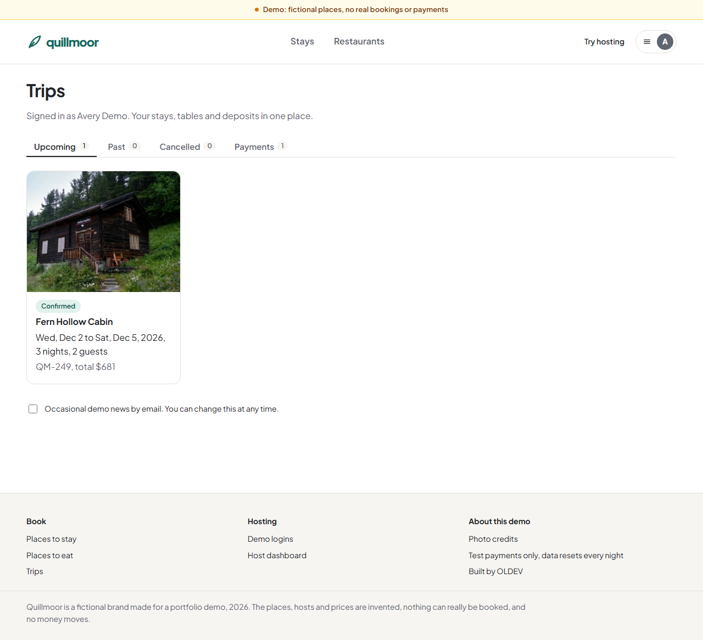 |

| Host dashboard | Host booking page |
|---|---|
| 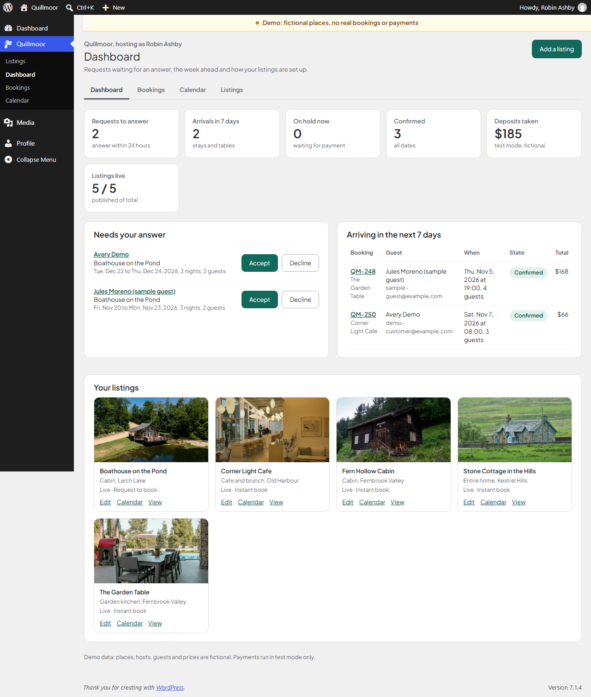 | 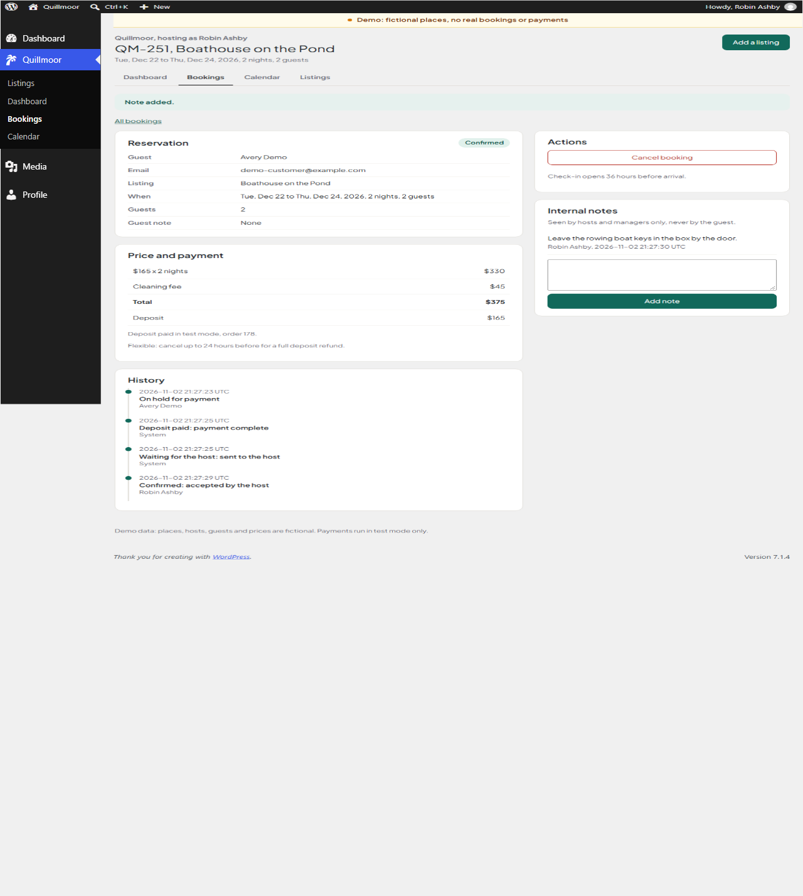 |

| Host calendar | Listing editor |
|---|---|
| 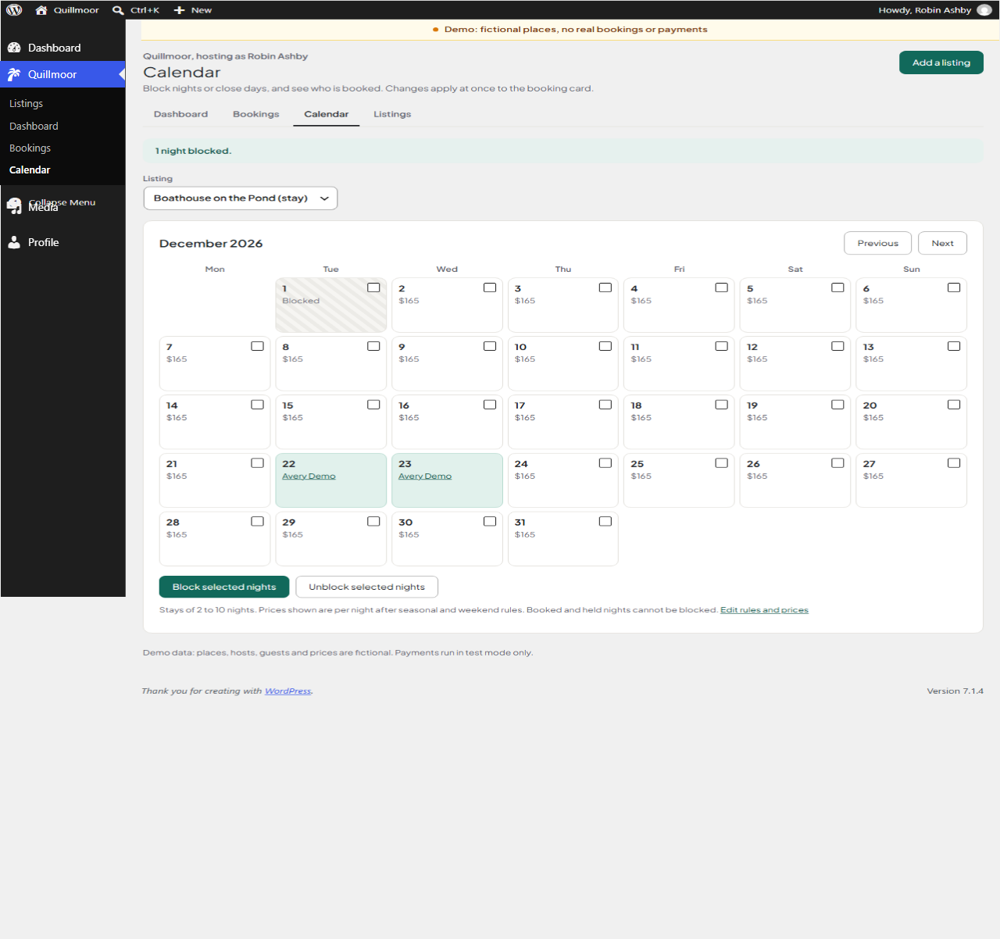 | 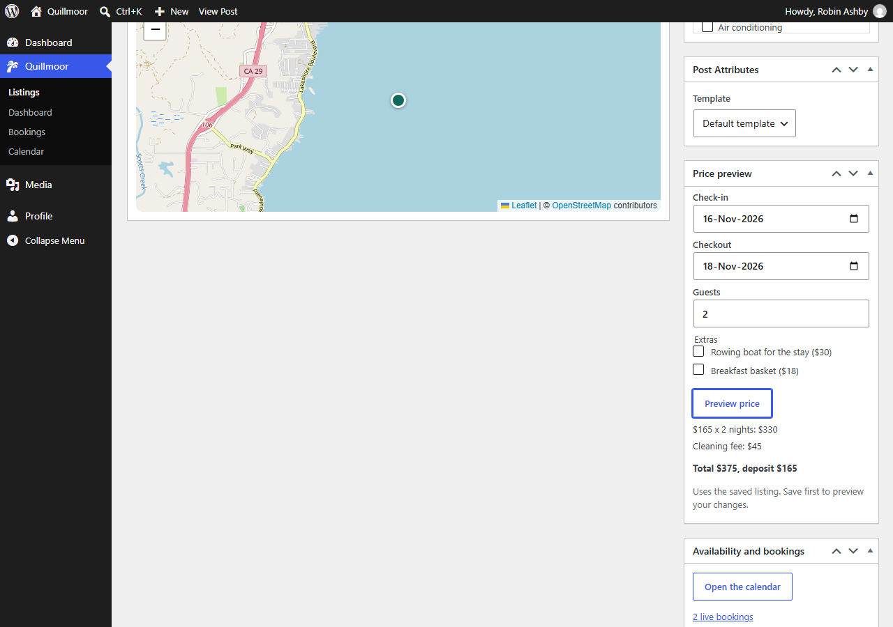 |

| Phone: home | Phone: listing | Phone: table on hold |
|---|---|---|
| 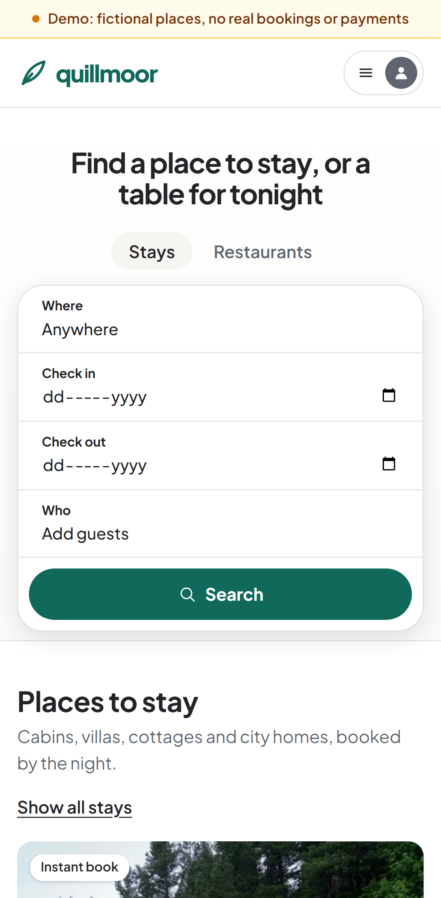 | 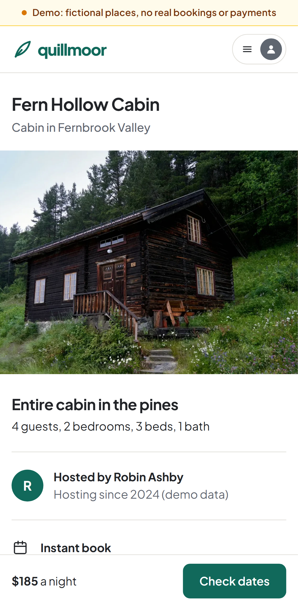 | 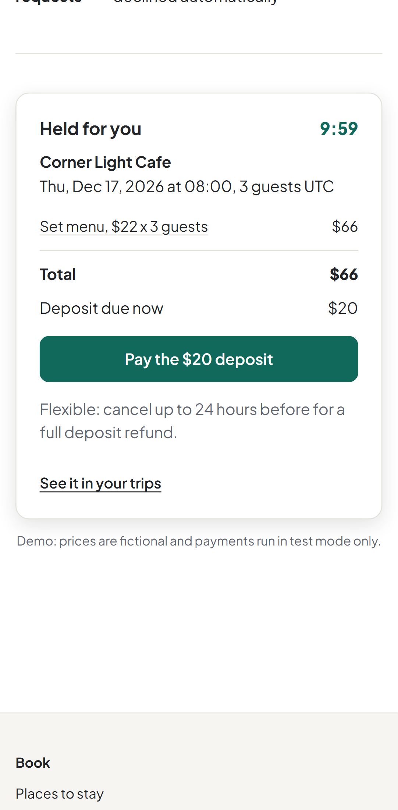 |

These are captures from the automated test run, which uses the labelled local fake gateway.

## Run it locally

You need Docker and Node 22.

```sh
cp .env.example .env
```

Edit `.env`:

- Replace every `change-me` with a random value.
- Set `WP_HOME=http://localhost:18091`, `QHS_DEMO_HOST=localhost` and `QHS_PAYMENT_MODE=fake`.
- Use Cloudflare's published Turnstile test keys: site key `1x00000000000000000000AA`, secret
  `1x0000000000000000000000000000000AA`.
- Set `QHS_N8N_EVENTS_URL=http://n8n:5678/webhook/qhs-booking-events` and
  `QHS_N8N_TRIAGE_URL=http://n8n:5678/webhook/qhs-booking-triage`.
- Raise `QHS_LIMIT_QUOTE_PER_MIN` and `QHS_LIMIT_HOLD_PER_MIN` to 200 for the test suites.

Then:

```sh
docker compose --env-file .env -f docker-compose.yml -f docker-compose.local.yml up -d --build
sh scripts/n8n-local-import.sh
```

| Service | URL |
|---|---|
| Site | http://localhost:18091 |
| Dispatch | http://localhost:18092 |
| Local n8n | http://localhost:18093 |

Fake payment mode exists for local tests only. It is clearly labelled, it is not Stripe, and it
moves no money.

## Tests

Composer packages for the plugin must be installed first:

```sh
docker run --rm -v "$PWD/wordpress/plugin/quillmoor-booking":/app -w /app composer:2.11.1 composer install --ignore-platform-reqs
docker run --rm -v "$PWD/dispatch":/app -w /app composer:2.11.1 composer install --ignore-platform-reqs --no-scripts
```

```sh
# WordPress integration tests: real WooCommerce and FluentCRM against MariaDB
sh scripts/test-wp.sh

# PHPCS and PHPStan
docker run --rm -v "$PWD/wordpress":/w -w /w/plugin/quillmoor-booking php:8.5.12-cli php vendor/bin/phpcs
docker run --rm -v "$PWD/wordpress":/w -w /w/plugin/quillmoor-booking php:8.5.12-cli php vendor/bin/phpstan analyse --memory-limit=1G

# Laravel tests
docker run --rm -v "$PWD/dispatch":/app -w /app php:8.5.12-cli vendor/bin/phpunit

# Parallel holds against the running stack
node tests/concurrency/parallel-hold.mjs

# Breaks each security rule in turn and confirms the suite notices
python scripts/mutation-check.py
# Before a commit: confirms every guarded line is back as written
python scripts/mutation-check.py --check-originals

# Browser tests at desktop and phone width
cd tests/e2e && npm ci && npx playwright install chromium && npx playwright test
```

### Results from the last full run

| Check | Result |
|---|---|
| WordPress PHPUnit | 415 tests, 1630 assertions, passing on PHP 8.5 with WooCommerce, FluentCRM and Secure Custom Fields loaded |
| Laravel PHPUnit | 21 tests, 55 assertions, passing |
| PHPCS (WordPress-Core and WordPress-Extra) | no errors or warnings in the plugin and the theme |
| PHPStan level 6 | no errors |
| Playwright | 6 tests at desktop and 6 at phone width, 12 passed with Wordfence active, including a guest who books and pays without an account, with no sideways scroll on the public pages |
| Parallel holds | 6 rounds of 10 truly parallel requests: 1 winner for the same nights, 1 winner per night for overlapping ranges, and exactly as many tables as the slot capacity allows |
| Mutation check | 16 of 18 mutations caught, including an account created before payment and the daily account cap ignored. Two survive and also survived before these changes: removing the host id check in `BookingPolicy::is_host` (the listing author check still holds) and dropping the version check on dispatch decisions |

These runs used the labelled fake gateway; the real Stripe test payment has not been run yet because
no test keys are configured. The concurrency script verifies Turnstile with Cloudflare's published
test keys, which needs internet access from the WordPress container.

## Demo logins

The password is shown on the `/demo/` page of the running site.

| Role | Username | Can do |
|---|---|---|
| Guest | `demo-customer` | Search, hold, pay a test deposit, change dates, cancel, download PDFs |
| Host | `demo-host` | Own listings only: edit, calendar, requests, check-in, notes, cancel, refund |
| Admin | `demo-admin` | Every host and booking, locations, categories, amenities, activity. Not a WordPress administrator |

Two more fictional hosts own the other listings; their accounts have random passwords. Demo accounts
cannot change their password or email. Data resets every night at 03:00 UTC.

## Deploying

See [DEPLOY.md](DEPLOY.md).

## Author

Built by **Lotfi Otmanine**, senior WordPress developer at [OLDEV](https://oldev.site).

- Website: [oldev.site](https://oldev.site)
- Hire me on Upwork: [upwork.com/freelancers/~01bd748fcb665b90ca](https://www.upwork.com/freelancers/~01bd748fcb665b90ca)
- LinkedIn: [linkedin.com/in/lotfi-otmanine](https://www.linkedin.com/in/lotfi-otmanine)
- GitHub: [github.com/Lotmanine](https://github.com/Lotmanine)
- Case study: [oldev.site/work/25-booking-and-quote-system](https://oldev.site/work/25-booking-and-quote-system/)

## Credits

- Photos: 56 photos from Unsplash, used under the Unsplash License, each credited with its
  photographer and source on the site's `/photo-credits/` page and in
  [docs/PHOTO-CREDITS.md](docs/PHOTO-CREDITS.md). The places shown are fictional.
- Map: Leaflet 1.9.4 (BSD 2-Clause), bundled in the plugin, with tiles and data from OpenStreetMap
  contributors.
- Font: Plus Jakarta Sans, self-hosted under the SIL Open Font License 1.1. The licence text is in
  `wordpress/theme/quillmoor/assets/fonts/`.

## Versions

WordPress 7.1.4, WooCommerce 11.2.1, WooCommerce Stripe Gateway 11.1.1, FluentCRM 3.3.1, Secure Custom
Fields 6.9.7, Wordfence 9.0.2, PHP 8.5.12, MariaDB 11.8.9, Laravel 13.39.0, n8n 2.45.7, Leaflet 1.9.4.
