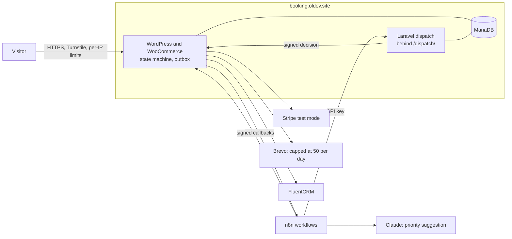
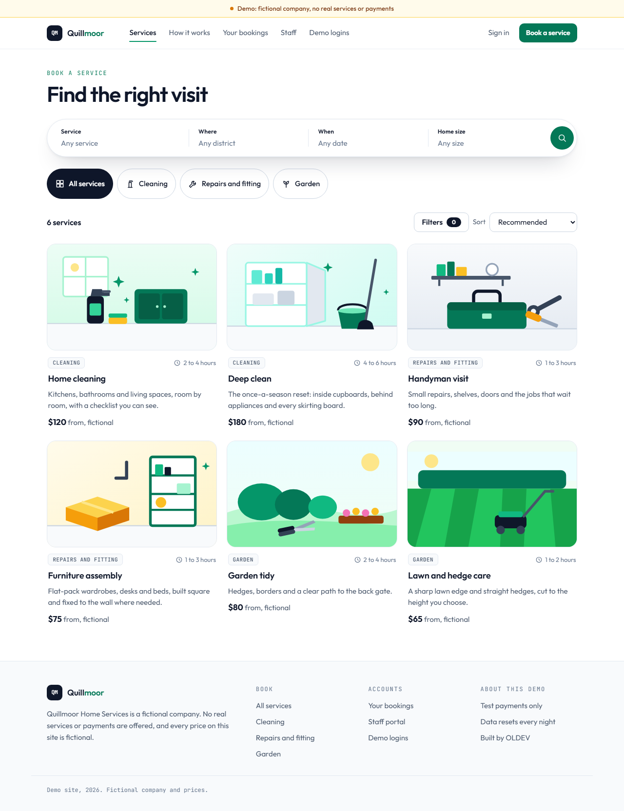
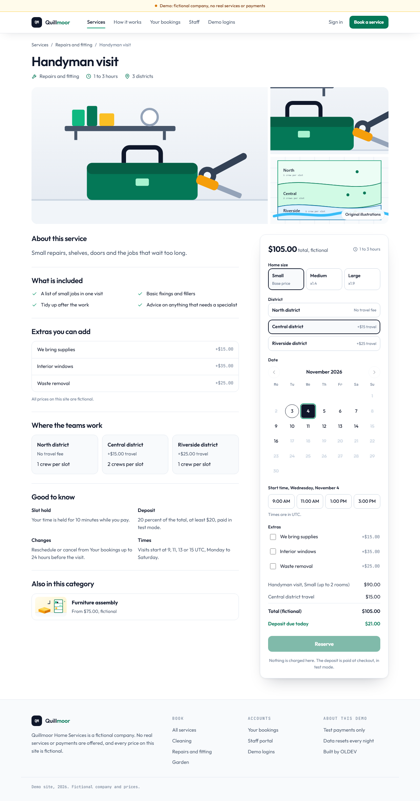
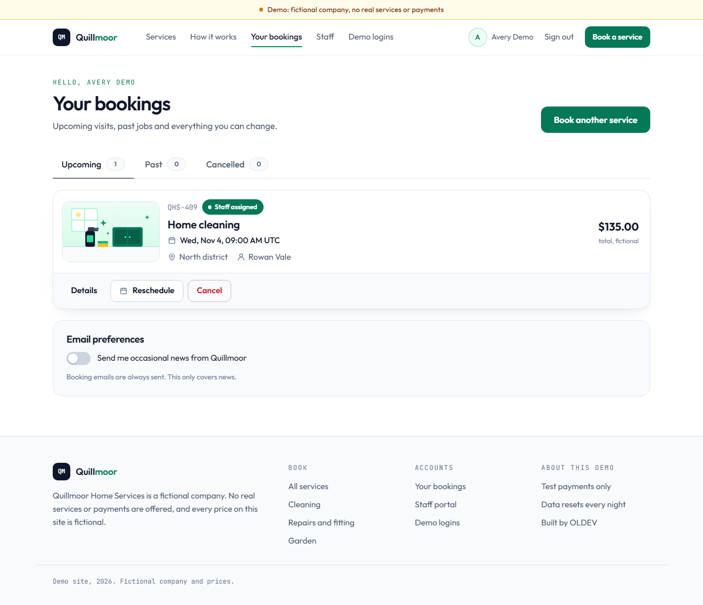
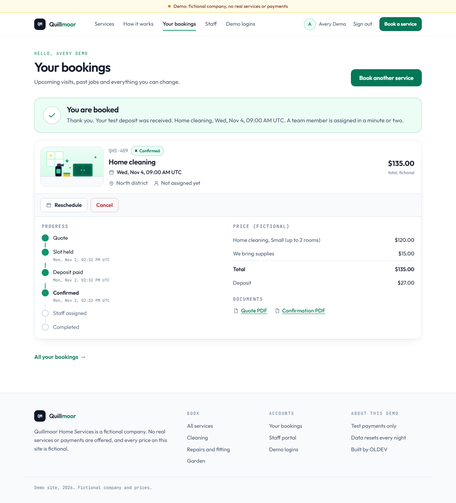
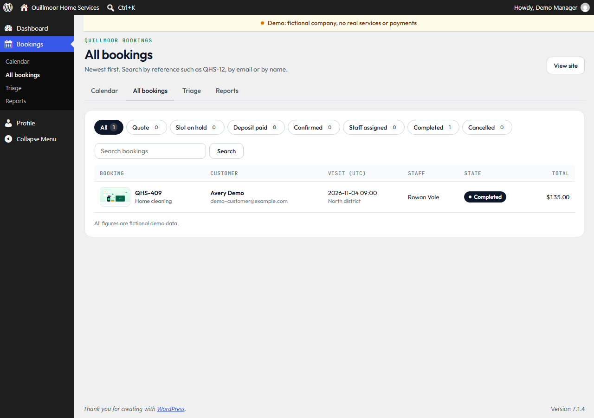

# Booking and Quote System

A working booking system for a fictional home services company, built on WordPress and
WooCommerce with a Laravel dispatch service and n8n automation. A visitor searches services, opens a
service page, picks a day and a time on the reservation card, holds the slot for ten minutes, pays a
test deposit, and staff take the job through to completion.

**Quillmoor Home Services is invented.** No real services or payments are offered, all prices are
fictional, and Stripe runs in test mode only.

Built by [Lotfi Otmanine](https://oldev.site).

## What it does

- **Search and results:** a pill search bar for service, district, date and home size, category
  chips, price and visit-length filters, and sorting.
- **Service pages:** gallery, what is included, extras, districts, and a sticky reservation card with
  a keyboard-operable calendar, start-time chips and a live price breakdown.
- **Pricing:** rule-based by service, size, area and extras. The card shows an estimate; the server
  computes the real price when the quote is created.
- **Availability and holds:** slots are held for ten minutes, then released automatically.
- **Double-booking protection:** a unique database key decides who gets a slot, so it holds under
  concurrent requests.
- **Deposits:** through WooCommerce and Stripe test mode, compatible with HPOS and the Checkout block.
- **State machine:** quote, hold, deposit paid, confirmed, assigned, completed or cancelled.
- **Portals:** customers get upcoming, past and cancelled tabs, a progress timeline, reschedule and
  cancel dialogs. Staff get a day agenda with a one-tap next step for each job.
- **Admin:** a month calendar, a searchable bookings list, triage and reports in wp-admin, plus PDF
  quotes and confirmations.
- **Dispatch:** a Laravel service assigns staff by area, skill and load, and answers over signed requests.
- **Automation:** n8n handles booking events, reminders, follow-ups, alerts and AI triage of
  customer notes. AI suggestions wait for a person and never change a booking by themselves.
- **CRM:** FluentCRM stages and tags follow booking events, with double opt-in consent.
- **Demo safety:** a banner on every page, restricted demo logins and a nightly reset.

## Architecture



WordPress owns the booking state. n8n and the dispatch service can only ask for changes through
signed callbacks, and every change passes through one state machine. See [PLAN.md](PLAN.md) for the
data model, the state table, the message contracts and the threat model.

### Decisions worth a look

**The database decides who gets a slot.** Claiming one is a single `INSERT IGNORE` against
`UNIQUE(area, slot_start, unit)`, so there is no gap between checking and writing. State changes are
conditional updates: `UPDATE ... WHERE id = ? AND state = ?`. One row changed means the caller won.

**Signed messages survive JSON parsers.** The payload travels as a JSON string inside JSON, so its
exact bytes reach the verifier even through an n8n webhook. Every receiver checks the key id, a 300
second timestamp window, the signature in constant time, and then a single-use nonce.

**A late answer cannot do damage.** A dispatch decision carries the booking version it was made for,
so an answer about an old slot is ignored after a reschedule.

**Live payments are impossible by construction.** `sk_live_`, `rk_live_` and `pk_live_` values are
refused at boot and on save, and a live key closes every booking route and removes every gateway.

**Events are stored before they are sent.** An outbox row is written with each state change, and a
job delivers it with retries, so an n8n outage delays side effects and loses nothing.

**The interface is a custom plugin, not a booking plugin.** Search, results, the service page, the
portal and the staff agenda are five dynamic blocks in `quillmoor-booking`, written in plain
JavaScript on top of the plugin's own REST routes. Pages render on the server first, so the search
form and the service details work before any script runs. The theme is a block theme with its own
header and footer blocks, a mobile drawer, and the type and colour system of oldev.site in light
mode.

**The card says when booking is paused.** If Turnstile keys or a payment gateway are missing, the
reservation card lists what is missing up front instead of failing at the last step.

## Screenshots

| Home and search | Results with filters |
|---|---|
|  |  |

| Service page and reservation card | Slot on hold |
|---|---|
|  |  |

| Customer: your bookings | Customer: booking confirmed |
|---|---|
|  |  |

| Staff agenda | Admin calendar |
|---|---|
|  |  |

| Admin bookings list | Admin reports |
|---|---|
|  |  |

| Phone: search | Phone: service page | Phone: menu |
|---|---|---|
|  |  |  |

These are captures from the automated test run, which uses the local fake gateway.

## Run it locally

You need Docker and Node 22.

```sh
cp .env.example .env
```

Edit `.env`:

- Replace every `change-me` with a random value.
- Set `WP_HOME=http://localhost:18091`, `QHS_DEMO_HOST=localhost` and `QHS_PAYMENT_MODE=fake`.
- Use Cloudflare's published Turnstile test keys: site key `1x00000000000000000000AA`, secret
  `1x0000000000000000000000000000000AA`.
- Set `QHS_N8N_EVENTS_URL=http://n8n:5678/webhook/qhs-booking-events` and
  `QHS_N8N_TRIAGE_URL=http://n8n:5678/webhook/qhs-booking-triage`.
- Raise `QHS_LIMIT_QUOTE_PER_MIN` and `QHS_LIMIT_HOLD_PER_MIN` to 200 for the test suites.

Then:

```sh
docker compose --env-file .env -f docker-compose.yml -f docker-compose.local.yml up -d --build
sh scripts/n8n-local-import.sh
```

| Service | URL |
|---|---|
| Site | http://localhost:18091 |
| Dispatch | http://localhost:18092 |
| Local n8n | http://localhost:18093 |

Fake payment mode exists for local tests only. It is clearly labelled, it is not Stripe, and it
moves no money.

## Tests

Composer packages for the plugin must be installed first:

```sh
docker run --rm -v "$PWD/wordpress/plugin/quillmoor-booking":/app -w /app composer:2.11.1 composer install --ignore-platform-reqs
docker run --rm -v "$PWD/dispatch":/app -w /app composer:2.11.1 composer install --ignore-platform-reqs --no-scripts
```

```sh
# WordPress integration tests: real WooCommerce and FluentCRM against MariaDB
sh scripts/test-wp.sh

# PHPCS and PHPStan
docker run --rm -v "$PWD/wordpress":/w -w /w/plugin/quillmoor-booking php:8.5.12-cli php vendor/bin/phpcs
docker run --rm -v "$PWD/wordpress":/w -w /w/plugin/quillmoor-booking php:8.5.12-cli php vendor/bin/phpstan analyse --memory-limit=1G

# Laravel tests
docker run --rm -v "$PWD/dispatch":/app -w /app php:8.5.12-cli vendor/bin/phpunit

# Parallel holds against the running stack
node tests/concurrency/parallel-hold.mjs

# Breaks each security rule in turn and confirms the suite notices
python scripts/mutation-check.py

# Browser tests at desktop and phone width
cd tests/e2e && npm ci && npx playwright install chromium && npx playwright test
```

### Results from the last full run

| Check | Result |
|---|---|
| WordPress PHPUnit | 171 tests, 380 assertions, passing on PHP 8.5.12 |
| Laravel PHPUnit | 21 tests, 55 assertions, passing on PHP 8.5.12 |
| PHPCS (WordPress-Core and WordPress-Extra) | no errors or warnings in the plugin; the theme also passes WordPress-Extra |
| PHPStan level 6 | no errors |
| Playwright | 9 tests per width: 17 passed, 1 skipped (the drawer test runs at phone width only) |
| Parallel holds | 6 rounds of 12 parallel requests: 1 winner per slot, 2 where two crews exist |
| Control | with the unique key dropped, all 12 requests won, so the test does detect double booking |
| Mutation check | 16 of 16 deliberate security breaks caught |

These runs used the labelled fake gateway. The automation path ran through the exported n8n
workflows in a local n8n container, with real schedule ticks for reminders and follow-ups. With no
Anthropic key available locally, AI triage exercised its fallback path, not a live model answer.

`python scripts/prove-pipeline.py` repeats the automation proof. It can take over an hour, because it
waits for the real schedules.

## Demo logins

The password is shown on the `/demo/` page of the running site.

| Role | Username | Can do |
|---|---|---|
| Customer | `demo-customer` | Quote, book, reschedule, cancel |
| Staff | `demo-staff` | See assigned jobs, update status, review AI suggestions |
| Admin | `demo-admin` | Calendar, bookings list, reports and triage only. Not a WordPress administrator |

Demo accounts cannot change their password or email. Data resets every night at 03:00 UTC.

## Deploying

See [DEPLOY.md](DEPLOY.md).

## Credits

- Illustrations: original SVG files made for this project, in `wordpress/plugin/quillmoor-booking/assets/img/`.
- Fonts: Outfit and JetBrains Mono, self-hosted under the SIL Open Font License 1.1. The licence
  texts are in `wordpress/theme/quillmoor/assets/fonts/`.

## Versions

WordPress 7.1.4, WooCommerce 11.2.1, WooCommerce Stripe Gateway 11.1.1, FluentCRM 3.3.1, PHP 8.5.12,
MariaDB 11.8.9, Laravel 13.39.0, n8n 2.45.7.
